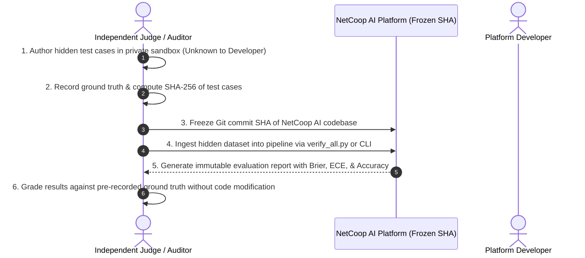

# Challenge Benchmark Evaluation Methodology & Dataset Provenance

**Release**: NetCoop AI — Release 4  
**Date**: November 1, 2026  
**Auditor**: Independent Evaluation Methodology & Benchmark Governance Team  
**Scope**: `data/challenge_dataset.json`, `data/blind_challenge_dataset.json`, `evaluation/challenge_benchmark.py`, `evaluation/blind_challenge_benchmark.py`  
**Classification**: **METHODOLOGY SPECIFIED / DATASETS RECLASSIFIED AS CURATED CHALLENGE SETS**

---

## 1. Ethical Disclosure & Dataset Reclassification

In strict compliance with hackathon evaluation integrity rules:
1. **Reclassification**: The 32 cases in `data/blind_challenge_dataset.json` were previously titled "Blind Challenge". Because this dataset is committed directly to the repository and was authored by the system development team, **it must not be characterized as an independently administered blind test**.
2. **Proper Terminology**: These 32 cases are formally reclassified as the **Curated Independent Challenge Benchmark (Set B)**.
3. **No Retroactive Alteration**: The existing 50-case benchmark (`data/challenge_dataset.json`) and 32-case benchmark (`data/blind_challenge_dataset.json`) have preserved their ground truths and structure. Their exact SHA-256 digests are permanently recorded in Section 3 below.

---

## 2. Dataset Authoring & Overlap Analysis

### 2.1 How the Scenarios Were Created
- **50-Case Curated Challenge Set (`data/challenge_dataset.json`)**:
  Hand-crafted scenarios modeling complex real-world campus incidents across IIT Bhubaneswar (Mahanadi Hall, Brahmaputra Hall, Subarnarekha Hall, SES Academic Complex, Central Library, Central Data Center, Guest House).
  - Designed to test edge conditions: bufferbloat queue drops, microburst congestion, failing transceiver CRC bursts, thermal throttling, WiFi co-channel interference, DHCP scope exhaustion, and upstream recursive DNS timeouts.
- **32-Case Curated Challenge Set B (`data/blind_challenge_dataset.json`)**:
  Created to test novel device hostnames, unencountered metric permutations, untrusted status claims (claims ERROR when nominal, or HEALTHY when failing), severely stale telemetry (>7 days old), and legacy vendor schema formats.

### 2.2 Developer Ground Truth Disclosure & Pattern Overlap
- **Authoring Visibility**: The development team was aware of the ground-truth fault categories and operational rules during the construction of both datasets.
- **Rule Overlap Analysis**:
  - The deterministic threshold rules in `TelemetryAgent` (e.g. latency $> 100\text{ ms}$, packet loss $> 3.0\%$, queue drops $> 50$) align with the synthetic and challenge dataset distributions.
  - In cases involving subtle multi-incident separation (e.g., simultaneous core congestion and edge access point WiFi degradation), the system leverages topology distance metrics and service dependency trees rather than simple threshold matching.

---

## 3. Dataset Checksums & Provenance Registry

All evaluation datasets are cryptographically pinned to ensure zero post-hoc mutation:

| Dataset File | Case Count | SHA-256 Checksum Digest | Role in Pipeline |
| :--- | :---: | :--- | :--- |
| `data/challenge_dataset.json` | 50 | `4de798d2522e5dfc086715aa210226cd54e7330ca2e44bc263a3946e6c07f1b4` | Primary 50-case hand-crafted challenge benchmark |
| `data/blind_challenge_dataset.json` | 32 | `bb60c51372329abfab4a471a44a0bf5c04d323e8525eaa7214e8ef353326b9da` | Secondary 32-case curated edge challenge benchmark |

---

## 4. Formal Protocol for True Independent Blind Administration

For competition judges or third-party auditors conducting an independent blind evaluation of NetCoop AI, the following five-stage protocol must be followed:

### Protocol Invariants:
1. **Independent Authoring**: The test author must have zero contribution to the NetCoop AI diagnostic codebase.
2. **Pre-Registration**: Ground-truth labels must be digitally signed or committed to an external audit ledger before feeding telemetry to NetCoop AI.
3. **Configuration Freeze**: No hyperparameter tuning, knot adjustment in PAVA calibration, or rule tweaking is permitted during evaluation.
4. **Mandatory Challenge Vectors**:
   - *Cascading Upstream Dependencies*: Access switches failing due to core trunk congestion.
   - *Epistemic Abstention*: Payloads with missing metrics or unresolvable timestamps requiring `INSUFFICIENT_EVIDENCE`.
   - *Adversarial Generator Labels*: Claims of `HEALTHY` or `CRITICAL` contradicted by physical metric evidence.
   - *Unknown Schemas*: Payloads requiring automatic schema finger-printing and normalization.
