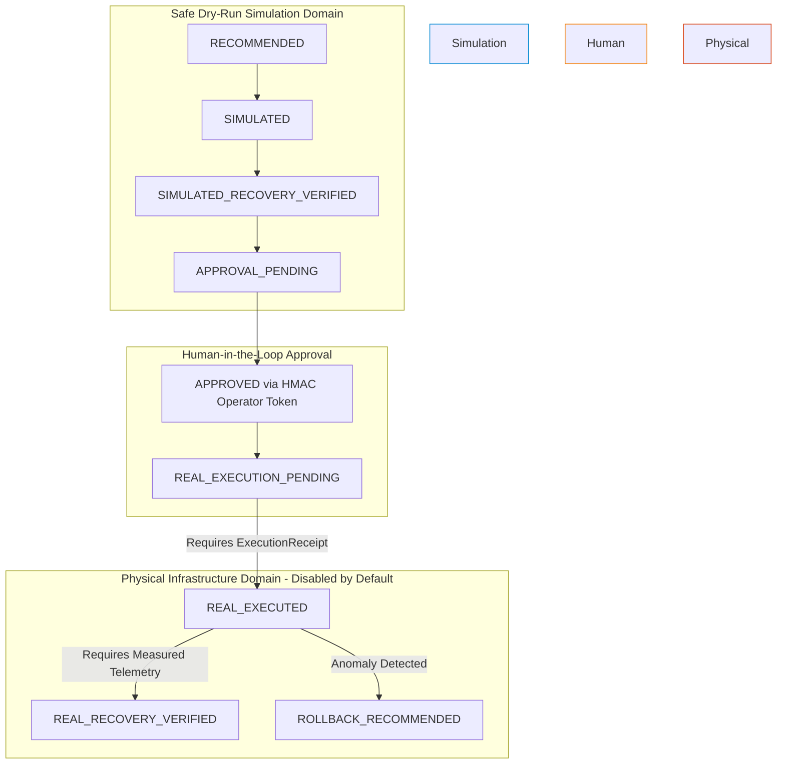

# Remediation Execution Integrity & Receipt Contract Report

**Release**: NetCoop AI — Release 4  
**Date**: November 1, 2026  
**Auditor**: Independent Network Automation & System Safety Audit Team  
**Scope**: `core/remediation.py`, `evaluation/test_remediation_lifecycle.py`  
**Status**: **VERIFIED COMPLETE (STRICT EXECUTION RECEIPT CONTRACT / SIMULATION ISOLATION)**

---

## 1. Executive Summary

A critical weakness in naive automated network operations platforms is the assumption that *approving* an action is equivalent to *executing* it. In physical campus networks, configuration pushes can fail due to SSH timeouts, TACACS authorization rejections, syntax errors on specific switch firmware, or device unreachable states.

NetCoop AI Release 4 introduces a formal **Execution Receipt Contract**. The platform's 10-state remediation lifecycle machine strictly forbids transitioning into `REAL_EXECUTED` based on an authorization approval alone. An authentic, signed `ExecutionReceipt` from a registered execution adapter is mandatory.

Furthermore, `REAL_RECOVERY_VERIFIED` strictly refuses to transition without measured post-execution telemetry meeting defined nominal recovery thresholds.

---

## 2. The Execution Receipt Contract

To advance to `REAL_EXECUTED`, the lifecycle engine requires an `ExecutionReceipt` verifying 11 distinct attributes:

| Field | Type | Description |
| :--- | :--- | :--- |
| `execution_adapter_id` | `str` | Registered adapter identifier (e.g., `CISCO-IOSXE-SSH-ADAPTER`). |
| `execution_id` | `str` | Unique, traceable execution dispatch transaction ID. |
| `incident_id` | `str` | Must match the active incident context. |
| `action_id` | `str` | Exact remediation action executed (must be in authorized list). |
| `operator_id` | `str` | Must match the authenticated operator on the authorization token. |
| `authorization_ref` | `str` | Cryptographic reference/digest of the parent authorization token. |
| `execution_timestamp` | `datetime` | Precise physical dispatch timestamp. |
| `target_device` | `str` | Target switch hostname/IP. |
| `execution_result` | `str` | Must be explicitly `"SUCCESS"`. |
| `adapter_response` | `Dict[str, Any]` | Raw structured response from the device driver. |
| `audit_reference` | `str` | Central syslog or operational ledger reference. |

---

## 3. Strict Boundary Between Simulation and Reality

NetCoop AI enforces strict isolation between dry-run simulation and live physical execution:

### Safety Policy:
- In the hackathon prototype, live switch mutation is **disabled by default** (`is_live_execution_enabled() == False`).
- Projected KPI improvements generated by `RemediationSimulator.simulate_remediation()` are marked `is_simulated_projection = True` and are never displayed as measured physical recovery.

---

## 4. Test Verification Summary

The lifecycle contract is validated in `evaluation/test_remediation_lifecycle.py`:
- `test_remediation_lifecycle_valid_complete_progression`: Demonstrates the full sequence with both authorization and execution receipts validated.
- `test_security_execution_receipt_contract_enforced`: Proves that providing only an authorization token triggers an immediate `ExecutionSafetyGuardError`.
- `test_security_real_recovery_verified_requires_actual_telemetry`: Proves that transitioning to `REAL_RECOVERY_VERIFIED` without measured physical telemetry is blocked.
