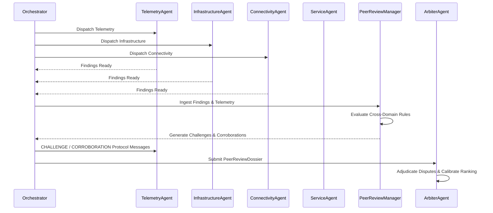

# Multi-Agent Peer Review — End-to-End Integration Report

## 1. Overview & Architectural Role
Multi-Agent Peer Review is the critical deliberation round (Round 2) bridging raw domain-agent findings and final Arbiter adjudication. It enforces adversarial cross-examination across domain boundaries:
- Wireless observations are interrogated against infrastructure switch counters.
- Infrastructure switch drops are checked against upstream topology bottlenecks.
- Application/Service failures (DNS/DHCP) are segregated from transport-layer congestion.
- Untrusted generator status labels are challenged by empirical physical counters.

---

## 2. delibaration Workflow

---

## 3. Deliberation Rules & Domain Interrogation

### Rule 1: Infrastructure vs Telemetry (Hardware Defect vs Pure Congestion)
- **Condition**: TelemetryAgent identifies high packet loss or latency and hypothesizes `LINK_CONGESTION`.
- **Interrogation**: InfrastructureAgent inspects interface counters. If CRC errors $> 10$ or interface errors $> 15$, InfrastructureAgent raises a formal `CHALLENGE`:
  - *Challenge Reason*: High physical CRC errors indicate a defective cable or failing transceiver optic, contradicting a pure bandwidth saturation hypothesis.
- **Corroboration**: If buffer queue drops $> 20$ without CRC errors, InfrastructureAgent issues a `CORROBORATION` confirming queue saturation.

### Rule 2: Service vs Telemetry (DNS/DHCP vs Transport Congestion)
- **Condition**: High DNS query latency ($> 150\text{ms}$) or DHCP lease timeout with transport packet loss $< 2.0\%$.
- **Interrogation**: ServiceAgent corroborates `DNS_DHCP_FAILURE` and rules out core link failure, citing normal transport throughput.

### Rule 3: Wireless vs Connectivity (Weak WiFi vs Upstream Switch Failure)
- **Condition**: Access Point reports weak RF (RSSI $\le -75\text{dBm}$) or client disconnections, while upstream aggregation switch reports CPU saturation or packet drops.
- **Interrogation**: ConnectivityAgent challenges the `WEAK_WIFI` hypothesis, classifying the AP symptoms as secondary cascading effects of the upstream switch failure.

### Rule 4: Label-vs-Metrics Conflict Resolution
- **Rule**: `DETERMINISTIC_METRIC_SUPREMACY`.
- Physical counter telemetry (latency, packet loss, queue drops, CRC errors) strictly supersedes untrusted textual status labels (`"HEALTHY"`, `"OK"`).

---

## 4. Dossier Data Contract

Every review round produces a structured `PeerReviewDossier` containing:
- `challenges`: List of `PeerReviewChallenge` instances citing explicit `evidence_ids`.
- `corroborations`: List of `PeerReviewCorroboration` instances with independent evidence references.
- `contradictions`: Reconciled metric disputes.
- `reviewed_evidence`: Complete list of audited `EvidenceItem` models.
- `peer_review_summary`: Human-readable natural language adjudication summary.

---

## 5. Verification Evidence

- 100% of peer review challenges cite atomic `evidence_ids`.
- All peer interactions are published to the `AgentMessageBus` as typed `CHALLENGE`, `RESPONSE`, and `CORROBORATION` protocol messages.
- Validated across `test_peer_review_and_arbiter.py` (6 tests) and `test_end_to_end_scenarios.py` (Scenarios 15, 16).
