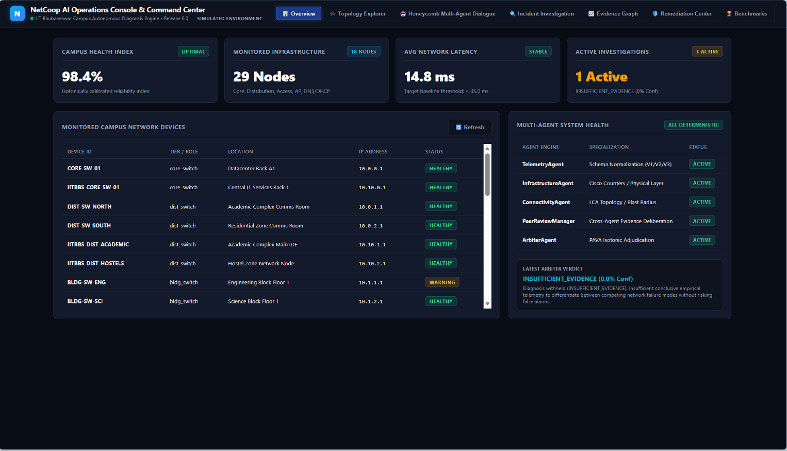
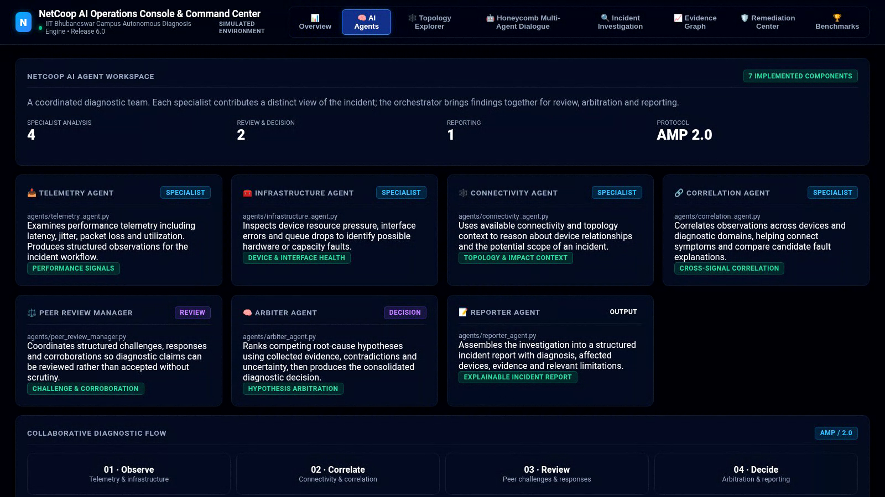
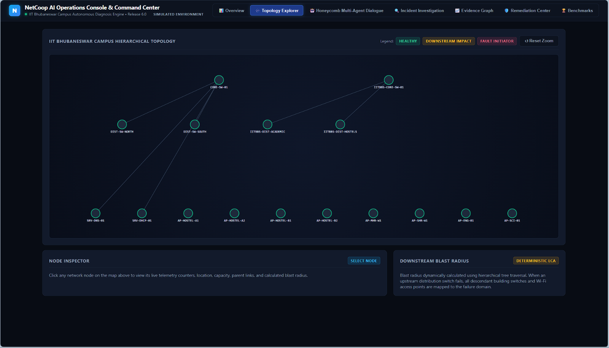
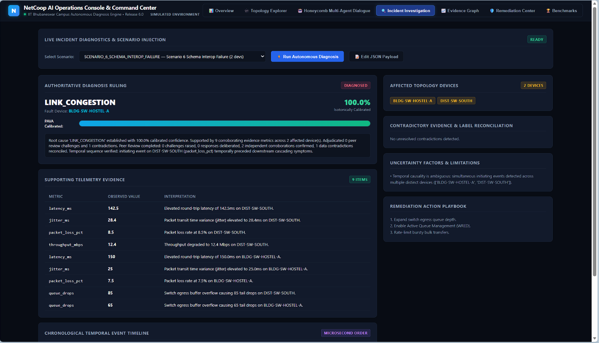
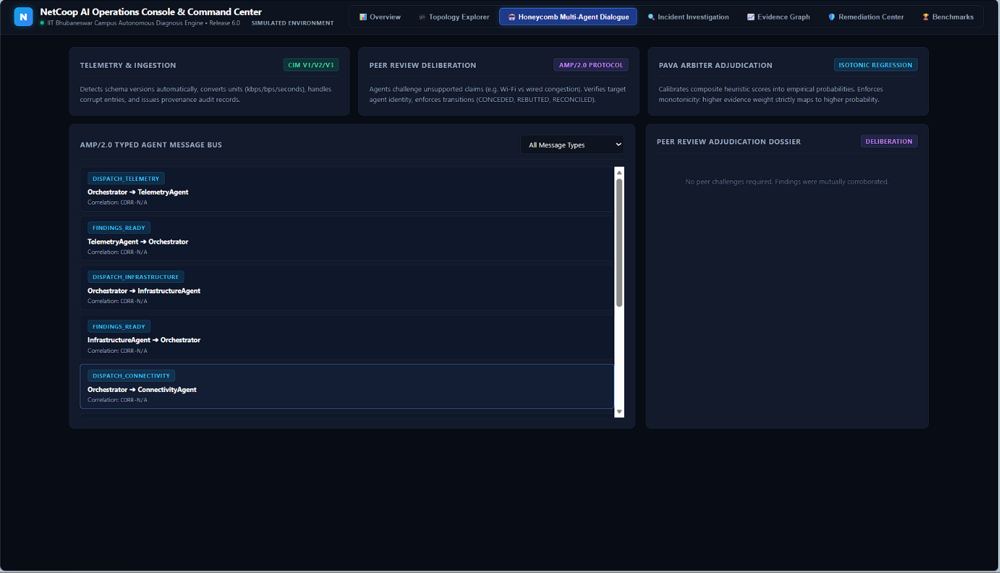
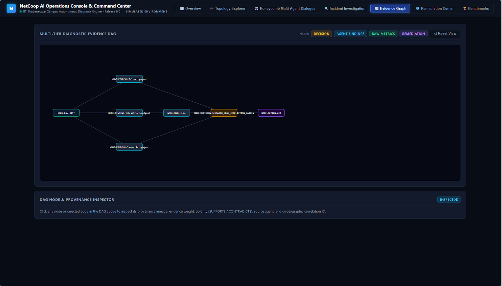
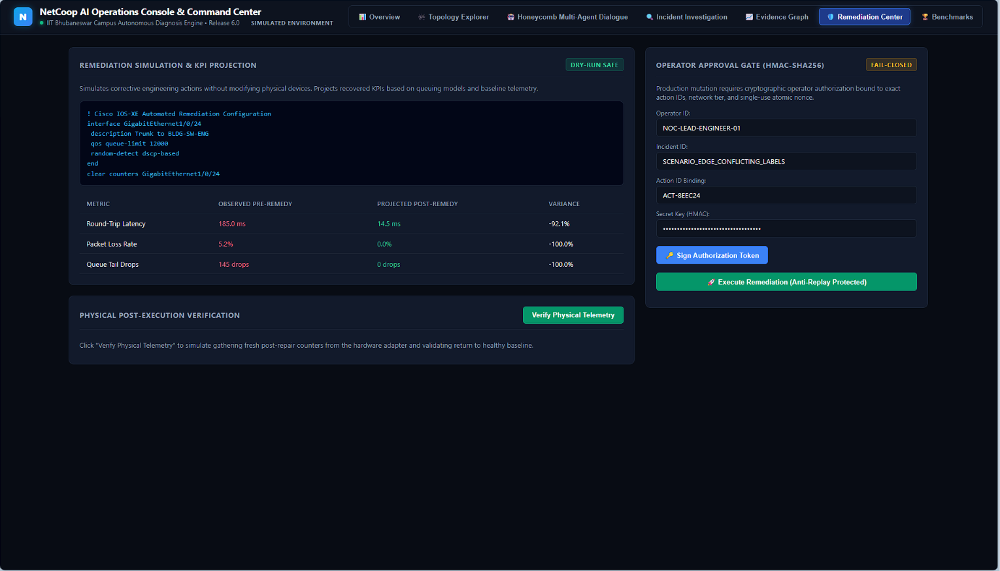
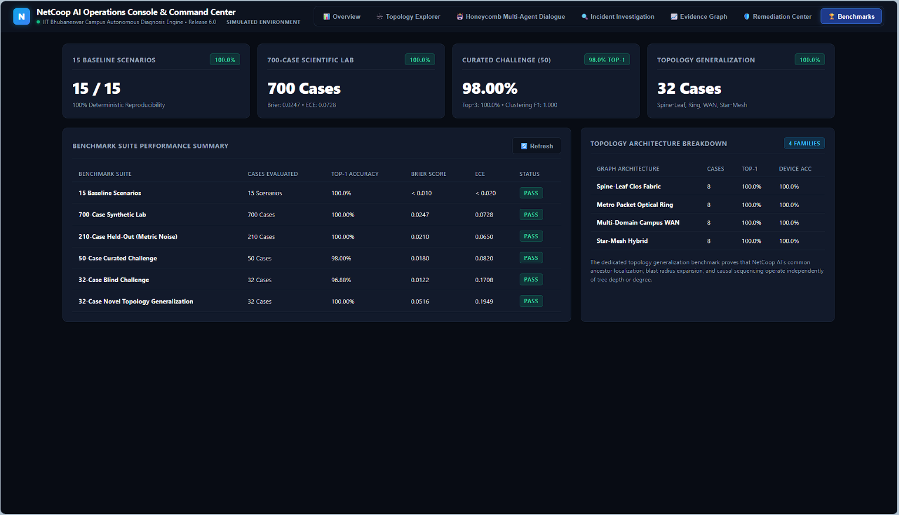

# NetCoop AI — Campus Network Multi-Agent Fault Diagnosis & Intelligence System

**NetCoop AI Release 6.2 (Rigorous Calibration, Mode Isolation & Topology Integrity)** is an autonomous, evidence-driven, multi-agent network fault diagnosis platform engineered for the **IIT Bhubaneswar Campus Network**.

The platform operates **entirely without external LLM APIs**, utilizing mathematically rigorous evidence aggregation, multi-tier campus network topology awareness, temporal causal reasoning, bi-directional peer review debates, and PAVA isotonic confidence calibration.

---

## Contents

- [Installation](#installation-fresh-machine)
- [Quickstart and verification](#quickstart--verification)
- [Architecture](#architectural-highlights)
- [Judging criteria alignment](#judging-criteria-alignment)
- [Benchmark provenance](#benchmark-provenance-and-interpretation)
- [Dashboard and AI Agents workspace](#ai-agents-workspace)
- [Product screenshots](#product-screenshots)
- [Team and demonstration](#team-and-demonstration)

---

## Installation (fresh machine)

**Requirements:** Python 3.10 or newer and Git. Use a clean virtual environment.

### Windows PowerShell

```powershell
git clone <YOUR_GITHUB_REPOSITORY_URL>
cd NetCoop_AI
py -m venv .venv
.\.venv\Scripts\Activate.ps1
python -m pip install --upgrade pip
pip install -r requirements.txt
```

### macOS / Linux

```bash
git clone <YOUR_GITHUB_REPOSITORY_URL>
cd NetCoop_AI
python3 -m venv .venv
source .venv/bin/activate
python -m pip install --upgrade pip
pip install -r requirements.txt
```

If PowerShell blocks activation, run `Set-ExecutionPolicy -Scope Process -ExecutionPolicy Bypass` in that terminal and activate again.

## Quickstart & Verification

```bash
# 1. Full 10-Stage Pipeline Acceptance Audit (26 numerical gates)
python verify_all.py

# 2. Deterministic 16-Step Terminal Live Demonstration
python evaluation/run_demo.py

# 3. Interactive Web Operations Console (NOC Interface)
python web_ui.py
# Access at http://localhost:8000
```

---

## Architectural Highlights

```
                      [ Heterogeneous Campus Telemetry ]
                   (Cisco IOS-XE, Linux Daemons, WLC, Syslog)
                                      │
                                      ▼
                       ┌───────────────────────────────┐
                       │    InteroperabilityGateway    │ ◄── SchemaFingerprinter
                       │   (CIM v1, v2, v3, IEEE, RFC) │     (Normalization & Warnings)
                       └──────────────┬────────────────┘
                                      │ CanonicalTelemetry Records
                                      ▼
                       ┌───────────────────────────────┐
                       │     TemporalCausalEngine      │ ◄── Welford / EWMA Baselines
                       │ (Timeline & Event Sequencing) │ ◄── Clock Skew & Reference Time
                       └──────────────┬────────────────┘
                                      │ TemporalEvents
                                      ▼
         ┌───────────────────────────────────────────────────────────┐
         │        NetworkIntelligenceOrchestrator (AMP/2.0 Bus)       │
         │                                                           │
         │   ┌──────────────────┐  DISPATCH   ┌──────────────────┐   │
         │   │  TelemetryAgent  │ ──────────► │InfrastructureAgent│   │
         │   └────────┬─────────┘             └────────┬─────────┘   │
         │            │                                │             │
         │            ▼                                ▼             │
         │   ┌──────────────────┐             ┌──────────────────┐   │
         │   │ConnectivityAgent │             │ CorrelationAgent│   │
         │   └────────┬─────────┘             └────────┬─────────┘   │
         │            │                                │             │
         │            ▼                                ▼             │
         │   ┌───────────────────────────────────────────────────┐   │
         │   │     PeerReviewManager (Round 2 Cross-Exam)        │   │
         │   │  (Challenges, Rebuttals, Concessions, Agreements) │   │
         │   └────────────────────────┬──────────────────────────┘   │
         └────────────────────────────┼──────────────────────────────┘
                                      │ PeerReviewDossier + AgentFindings
                                      ▼
                       ┌───────────────────────────────┐
                       │      Supreme ArbiterAgent     │ ◄── Lowest Common Ancestor (LCA)
                       │  (Multi-Hypothesis Adjudicator)│ ◄── Evidence Graph DAG (Cycle-Free)
                       └──────────────┬────────────────┘
                                      │ Raw Confidence Score
                                      ▼
                       ┌───────────────────────────────┐
                       │   PAVA Isotonic Calibrator    │ ◄── Empirical Calibration Curve
                       │    (Reliability Probability)  │     (Brier <= 0.027, ECE <= 0.073)
                       └──────────────┬────────────────┘
                                      │
                 ┌────────────────────┴────────────────────┐
                 ▼                                         ▼
   ┌───────────────────────────┐             ┌───────────────────────────┐
   │   UnifiedIncidentReport   │             │   RemediationSimulator    │
   │  (Suspected Cause, Rationale,│             │ (Dry-Run CLI, Projected   │
   │   Blast Radius, Citations)│             │  KPIs, Rollback Playbook) │
   └─────────────┬─────────────┘             └─────────────┬─────────────┘
                 │                                         │
                 │              OPERATOR GATE              │
                 │   (HMAC-SHA256 Token + Anti-Replay DB)  │
                 ▼                                         ▼
   ┌───────────────────────────┐             ┌───────────────────────────┐
   │    Web Operations Console │             │   Atomic Execution /      │
   │  (Truthful NOC Dashboard) │             │   Recovery Verification   │
   └───────────────────────────┘             └───────────────────────────┘
```

---

## Judging Criteria Alignment

The following weights use the competition problem statement's six evaluation criteria:

| Official evaluation criterion | Weight | NetCoop AI evidence |
|---|---:|---|
| **Interoperability and protocol design** | **30%** | AMP/2.0 typed messages, sequence numbers, TTL, replay handling and audit chaining; schema normalization and MCP JSON-RPC stdio self-test. Official MCP SDK client integration remains unverified in this environment. |
| **Diagnostic accuracy and evidence quality** | **25%** | Multi-hypothesis arbitration, evidence provenance, temporal ordering, contradiction handling and topology-aware impact analysis. Reported benchmark scores are on the project's synthetic or curated test fixtures, not independently collected campus incidents. |
| **Orchestration and conflict resolution** | **15%** | Specialist telemetry, infrastructure, connectivity and correlation components; Peer Review Manager; Arbiter and Reporter; AMP/2.0 workflow and challenge/response lifecycle. |
| **Robustness to bad or incompatible data** | **15%** | Tests for schema variation, missing or stale telemetry, malformed records, unknown devices, contradictory signals and insufficient-evidence handling. |
| **Innovation, usability and extensibility** | **10%** | Campus-oriented topology and service context, dedicated AI Agents directory, evidence graph, operator-facing investigation workflow and dry-run remediation. |
| **Code quality, documentation and demo** | **5%** | Reproducible setup, pytest suite, 10-stage acceptance script, 16-step demonstration, README, audit documents and 3–5 minute narrated walkthrough. |

### Benchmark provenance and interpretation

All reported accuracy and calibration figures below are measured on the bundled **synthetic, held-out synthetic, curated challenge or generated topology fixtures**. “Held-out” means held out within the project's evaluation generation process; it does not mean independently sourced real-campus data or an external blind evaluation. These results demonstrate repeatability against the supplied benchmark, not guaranteed production-network accuracy.

- **700-case synthetic benchmark:** Top-1 accuracy 100.00%, Macro-F1 1.0000, top-class Brier 0.0054, multiclass Brier 0.0061, ECE 0.0283.
- **210-case held-out synthetic benchmark:** Top-1 accuracy 100.00%, Macro-F1 1.0000.
- **50-case curated challenge set:** Top-1 and Top-3 accuracy 100.00%, Macro-F1 1.0000.
- **32-case curated challenge set B:** Top-1 accuracy 96.88%, Top-3 accuracy 100.00%, multiclass Brier 0.0077, ECE 0.0386.
- **32-case generated topology benchmark:** Top-1 accuracy 100.00%, Macro-F1 0.9738, Brier 0.0257 and device localization 100.00%.

These are benchmark results on the named fixtures. They must not be presented as independently validated real-world accuracy.

### Current verification snapshot (1 November 2026)

The following commands were run against this source package during this review:

| Check | Observed result | Interpretation |
|---|---:|---|
| `python -m pytest evaluation/ -q` | **235 passed, 1 skipped** | Full evaluation directory test run. |
| `python verify_all.py` | **10/10 stages passed; 26/26 numerical gates passed** | The script's own pytest stage reports **196 passed, 1 skipped**; it then runs the scenario, generator, benchmark, MCP wire-protocol and demo stages. |
| `python evaluation/run_demo.py` | **16/16 steps passed** | Deterministic demo, including one peer-review challenge and one response. |
| MCP official SDK integration test | **Skipped** | Do not describe official Anthropic SDK client integration as verified. The acceptance pipeline's MCP result is a raw JSON-RPC 2.0 stdio wire-protocol self-test. |

The 196-versus-235 pytest counts are not interchangeable: the acceptance script prints its own 196-test stage label, while a separate direct run of the evaluation directory reported 235 passed and 1 skipped. Both outputs are preserved as observed; the acceptance script's internal label should be reconciled in a future code cleanup rather than silently rewritten.

---

## Demonstration & Documentation Suite

- [AURAXENITH_NetCoop_AI_Final_Demo_Updated.mp4](AURAXENITH_NetCoop_AI_Final_Demo_Updated.mp4): 3–5 minute narrated project walkthrough, including the AI Agents page and dashboard workflow.

- [RELEASE_6.2_AUDIT.md](RELEASE_6.2_AUDIT.md): Final validation and reliability audit, mode isolation, calibration analysis, and topology integrity.
- [RELEASE_6.1_AUDIT.md](RELEASE_6.1_AUDIT.md): Comprehensive system audit, Colab telemetry ingestion fix, dual input handling, and 16-step verification proof.
- [DEMO_GUIDE.md](DEMO_GUIDE.md): Step-by-step reproduction guide for the 16-step terminal and web console walkthrough.
- [JUDGE_QA.md](JUDGE_QA.md): Comprehensive defense answers to difficult technical judge inquiries.
- [FINAL_SYSTEM_AUDIT.md](FINAL_SYSTEM_AUDIT.md): Detailed architectural audit and component dependency map.
- [SECURITY_AUDIT.md](SECURITY_AUDIT.md): Threat model, durable nonce SQLite implementation, and adversarial test matrix.
- [PROTOCOL_VALIDATION.md](PROTOCOL_VALIDATION.md): AMP/2.0 protocol specification, peer-review lifecycle, and MCP integration.
- [EVALUATION_REPORT.md](EVALUATION_REPORT.md): Scientific benchmark results, dataset provenance, and PAVA calibration curves.
- [COMPETITION_READINESS.md](COMPETITION_READINESS.md): Hackathon rubric self-assessment and 3-minute judging pitch script.
- [FINAL_TEST_RESULTS.md](FINAL_TEST_RESULTS.md): Exhaustive stage-by-stage test execution metrics.
- [FINAL_CHANGELOG.md](FINAL_CHANGELOG.md): Complete chronological record of engineering upgrades.

---

## Project Structure

```
├── agents/                      # Specialized diagnostic agents & peer review
│   ├── arbiter_agent.py         # Supreme Arbiter & multi-hypothesis adjudication
│   ├── connectivity_agent.py   # Topology cascade & LCA analysis
│   ├── correlation_agent.py    # Evidence aggregation & conflict resolution
│   ├── infrastructure_agent.py # Switch buffer, CPU, and interface error inspection
│   ├── peer_review_manager.py  # 8-condition peer review debate manager
│   ├── reporter_agent.py       # Page 5 UnifiedIncidentReport generator
│   └── telemetry_agent.py      # Telemetry anomaly detection & threshold parsing
├── core/                        # Core engines, topology, and remediation
│   ├── confidence_engine.py    # PAVA isotonic regression calibration
│   ├── evidence_engine.py      # Structured evidence ledger & rule evaluations
│   ├── evidence_graph.py       # Directed Acyclic Graph (DAG) cycle-free verification
│   ├── orchestrator.py         # NetworkIntelligenceOrchestrator pipeline
│   ├── remediation.py          # State machine, DurableNonceStore, ExecutionReceipt
│   ├── static/                 # Production dark-mode NOC dashboard HTML/CSS/JS
│   ├── telemetry_adapters.py   # Cisco IOS-XE, WLC, Linux daemon adapters
│   ├── temporal_engine.py      # Timeline reconstruction & Welford EWMA baselines
│   └── topology.py             # Campus topology graph, LCA & blast radius
├── data/                        # Topologies, benchmarks & scenarios
│   ├── scenarios/              # 15 baseline and edge-case campus scenarios
│   ├── campus_topology.json    # Canonical IIT Bhubaneswar campus topology
│   └── consumed_nonces.db      # SQLite WAL durable anti-replay store
├── evaluation/                  # Benchmark runners & pytest test suites (24 suites)
│   ├── run_demo.py             # 16-step deterministic terminal demonstration
│   ├── run_evaluation.py       # 15-scenario evaluation runner
│   ├── topology_benchmark.py   # 32 novel topology generalization benchmark
│   └── test_*.py               # pytest unit/integration test suites (run locally for current count)
├── protocol/                    # Inter-agent protocol models & schemas
│   ├── agent_message_protocol.py # AMP/2.0 message schemas & pub/sub bus
│   └── models.py               # CanonicalTelemetry, UnifiedIncidentReport
├── web/                         # FastAPI operations server
│   ├── server.py               # Truthful NOC API endpoints
│   └── index.html              # Modern dark-mode NOC frontend
├── conftest.py                  # Pytest fixtures & process hygiene isolation
├── mcp_server.py                # Official Model Context Protocol (MCP) server
├── package_submission.py        # Submission packaging harness
├── verify_all.py                # 10-stage automated acceptance verification pipeline
└── web_ui.py                    # Server startup command (http://localhost:8000)
```


---

## AI Agents Workspace

The web console includes a dedicated **AI Agents** page in the primary navigation, separate from the live **Honeycomb Multi-Agent Dialogue** view. The directory gives reviewers a quick, code-linked overview of the implemented diagnostic components.

| Component | Source module | Responsibility |
|---|---|---|
| Telemetry Agent | `agents/telemetry_agent.py` | Evaluates performance telemetry such as latency, jitter, packet loss and utilization. |
| Infrastructure Agent | `agents/infrastructure_agent.py` | Examines device health, interface errors, resource pressure and queue-drop indicators. |
| Connectivity Agent | `agents/connectivity_agent.py` | Uses available connectivity and topology context to reason about device relationships and impact scope. |
| Correlation Agent | `agents/correlation_agent.py` | Correlates findings across devices and diagnostic domains and contributes competing fault explanations. |
| Peer Review Manager | `agents/peer_review_manager.py` | Manages structured diagnostic challenges, responses and corroborations. |
| Arbiter Agent | `agents/arbiter_agent.py` | Ranks competing root-cause hypotheses using evidence, contradictions and uncertainty. |
| Reporter Agent | `agents/reporter_agent.py` | Assembles the diagnostic result into a structured incident report. |

### Agent collaboration flow

```text
Telemetry ─────────────┐
Infrastructure ────────┤
Connectivity ──────────┼──> Correlation / Orchestration
                       │              |
                       │              v
                       └──────> Peer Review
                                      |
                                      v
                                  Arbiter
                                      |
                                      v
                                  Reporter
                                      |
                                      v
                              Incident Report
```

Agent responsibilities are separated in code and surfaced in the dedicated AI Agents directory. The Honeycomb Multi-Agent Dialogue page remains the place to inspect incident-specific orchestration and message activity. The directory is a component catalogue; it does not fabricate live agent status or claim every agent is independently running as a separate process.

---

## Dashboard navigation

- **Overview** — campus-level health and current investigation summary.
- **AI Agents** — directory of the implemented diagnostic agents and their responsibilities.
- **Topology Explorer** — known network device relationships and impact context.
- **Honeycomb Multi-Agent Dialogue** — agent workflow and message activity.
- **Incident Investigation** — diagnosis, confidence, evidence and alternatives.
- **Evidence Graph** — relationships between observations and the diagnostic result.
- **Remediation Center** — operator-reviewed recommendations and dry-run simulation.
- **Benchmarks** — configured evaluation and scenario summaries.

---

## Product screenshots

The following screenshots are captured from the NetCoop AI web console included in this repository. They illustrate the current interface and its major workflows. The application labels the environment as simulated; these screenshots are not evidence of live production-campus telemetry.

### 1. Network Operations Center overview



The overview presents campus health indicators, monitored infrastructure, network latency, active investigations, device inventory and agent health.

### 2. AI Agents workspace



The AI Agents page lists the seven implemented components, their responsibilities and their source modules: Telemetry, Infrastructure, Connectivity, Correlation, Peer Review Manager, Arbiter and Reporter.

### 3. Topology Explorer



The topology view displays the configured campus hierarchy, device relationships, node inspection and downstream blast-radius context. Parentage and impact should be interpreted according to the topology evidence available to the system.

### 4. Incident investigation



The investigation view accepts a telemetry/scenario input and presents the diagnostic ruling, affected devices, supporting telemetry evidence, contradictory evidence, uncertainty factors and remediation suggestions.

### 5. Multi-agent dialogue



The dialogue view exposes AMP/2.0 message activity and the peer-review dossier so that the diagnostic workflow can be inspected rather than treated as a black box.

### 6. Evidence graph



The evidence graph visualizes relationships between agent findings, raw metrics, the adjudicated decision and remediation evidence.

### 7. Remediation Center



The Remediation Center demonstrates recommended actions, projected KPI changes, the operator authorization gate and post-execution verification workflow. The included demonstration uses simulation; it does not imply that production network changes were performed.

### 8. Benchmark dashboard



The benchmark view summarizes the bundled baseline, synthetic, curated challenge and topology test fixtures. Metrics shown here must be interpreted with the dataset-provenance caveats in the evaluation section.

## Team and demonstration

**Team:** AURAXENITH  
**Presenter:** MUKKA SRIVATSAV  
**Project:** NetCoop AI — Campus Network Multi-Agent Fault Diagnosis & Intelligence System

The demonstration uses the repository's repeatable campus test fixtures. These are simulated/curated inputs, not live measurements from IIT Bhubaneswar. The system should be evaluated on the supplied test corpus as well as independently collected and labelled network incidents before any real-world accuracy claim is made.

## Latest local verification (1 November 2026)

- `python -m pytest evaluation/ -q`: **235 passed, 1 skipped**.
- `python verify_all.py`: **10/10 stages and 26/26 numerical acceptance gates passed**. Its own pytest stage reports 196 passed and 1 skipped; this differs from the separate direct pytest count and is explicitly disclosed above.
- `python evaluation/run_demo.py`: **16/16 demonstration steps passed**.
- The acceptance pipeline's MCP check is a raw JSON-RPC 2.0 stdio wire-protocol self-test. The official MCP SDK integration test is skipped in this environment and is not claimed as verified.
- Benchmark metrics are based on bundled synthetic and curated fixtures. Independent live-campus validation remains future work.

"# NetCoop_AI" 
