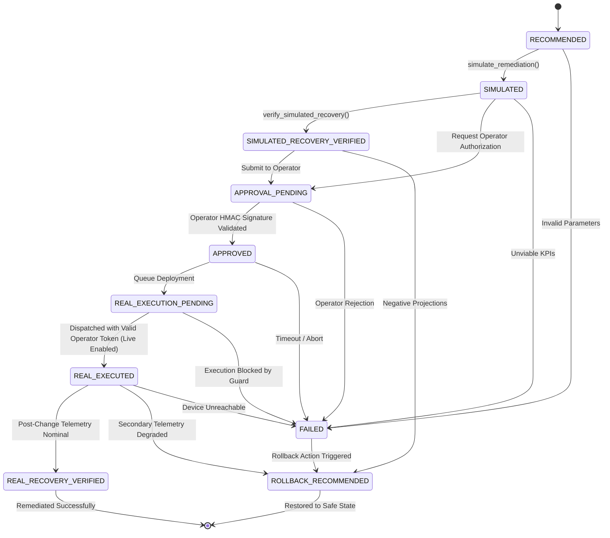

# NetCoop AI — Remediation Safety & 10-State Lifecycle Machine Report

**Release**: NetCoop AI — Release 3 Hardening  
**Date**: November 1, 2026  
**Auditor**: Independent Safety & Autonomous Remediation Review Team  
**Scope**: `core/remediation.py`, `evaluation/test_remediation_lifecycle.py`, `evaluation/test_remediation_security.py`  
**Status**: **VERIFIED (SAFE SIMULATION-ONLY BY DEFAULT / CRYPTOGRAPHIC OPERATOR APPROVAL)**

---

## 1. Executive Summary

Autonomous remediation of production campus networks poses catastrophic operational risks if execution boundaries and human-in-the-loop safeguards are ambiguous. NetCoop AI implements a formal **10-State Remediation Lifecycle State Machine** with hard cryptographic execution guards preventing unapproved live mutation.

In Release 3, all insecure hardcoded credentials have been removed. The platform operates in a **Safe Simulation-Only Mode** by default. Any live dispatch requires explicit runtime enablement, human operator review, and a dynamically computed HMAC-SHA256 operator authorization token.

---

## 2. Remediation State Machine Specification

---

## 3. The 10 Lifecycle States

| State | Role | Can Execute Live Commands? |
| :--- | :--- | :--- |
| `RECOMMENDED` | Action suggested by diagnostic root-cause playbook | **NO** (Advisory only) |
| `SIMULATED` | Dry-run simulated plan generated with before/after KPI projections | **NO** (Sandbox only) |
| `SIMULATED_RECOVERY_VERIFIED` | Mathematical recovery verification confirmed in simulation | **NO** (Audit only) |
| `APPROVAL_PENDING` | Change ticket submitted to NOC operator for manual approval | **NO** (Pending human review) |
| `APPROVED` | Operator has reviewed blast-radius, risks, and signed approval | **NO** (Staged) |
| `REAL_EXECUTION_PENDING` | Change window opened; pending final pre-flight safety check | **NO** (Pre-flight lock) |
| `REAL_EXECUTED` | Corrective configuration changes dispatched to target switch | **YES** (Only with valid operator HMAC & live flag) |
| `REAL_RECOVERY_VERIFIED` | Live post-change telemetry verified within nominal envelope | **NO** (Terminal success) |
| `FAILED` | Change rejected by operator, execution error, or timeout | **NO** (Failure state) |
| `ROLLBACK_RECOMMENDED` | Automatic rollback playbook generated to revert changes | **NO** (Requires rollback dispatch) |

---

## 4. Strict Execution Safety Guards & Provenance Flags

### 4.1 Safe Simulation-Only Default Mode
Live execution is strictly blocked unless the operational environment explicitly exports:
`NETCOOP_ENABLE_LIVE_EXECUTION="true"`

Without this environment variable, any call to execute changes raises an immediate `ExecutionSafetyGuardError`.

### 4.2 Cryptographic HMAC-SHA256 Operator Token
Instead of relying on a hardcoded shared password, approvals are cryptographically signed via `OperatorAuthorizationRecord`:
- Message payload: `{operator_id}:{incident_id}:{action_id}:{timestamp_iso}`
- Verified using constant-time `hmac.compare_digest()`.
- Captures operator identity, NOC role, and audit comments.

### 4.3 Provenance Flags
To eliminate ambiguity between simulated mathematical projections and physical switch telemetry:
- `SimulationResult`: `is_simulated = True`, `is_real_execution = False`
- `VerificationResult`: `is_simulated_projection = True`, `is_real_recovery_measured = False`

Transitions that attempt to falsely claim real execution from simulated projections are blocked by assertion invariants.

---

## 5. Verification Test Matrix

All safety controls are continuously verified across 9 unit tests:

| Test File | Test Name | Assertion Verified | Result |
| :--- | :--- | :--- | :--- |
| `test_remediation_lifecycle.py` | `test_remediation_lifecycle_valid_complete_progression` | Valid 10-state lifecycle progression with HMAC approval | **PASSED** |
| `test_remediation_lifecycle.py` | `test_remediation_execution_safety_guard_blocks_unauthorized` | Blocked transition without valid token or live flag | **PASSED** |
| `test_remediation_lifecycle.py` | `test_remediation_invalid_transitions_rejected` | Illegal state transitions raise `InvalidStateTransitionError` | **PASSED** |
| `test_remediation_lifecycle.py` | `test_remediation_failure_and_rollback_flow` | Execution abort transitions cleanly to `ROLLBACK_RECOMMENDED` | **PASSED** |
| `test_remediation_security.py` | `test_security_no_hardcoded_secrets_in_remediation_module` | Zero hardcoded plaintext keys in source | **PASSED** |
| `test_security_default_mode_is_simulation_only` | `test_security_default_mode_is_simulation_only` | `is_live_execution_enabled() == False` by default | **PASSED** |
| `test_remediation_security.py` | `test_security_simulation_cannot_claim_real_execution` | `is_simulated=True`, `is_real_execution=False` invariant | **PASSED** |
| `test_remediation_security.py` | `test_security_structured_operator_authorization_audit_record` | HMAC signature validation and forgery rejection | **PASSED** |
| `test_remediation_security.py` | `test_security_unauthorized_user_cannot_change_real_execution_state` | Unauthorized actor cannot mutate state | **PASSED** |

Total runtime: **0.88 seconds**.
